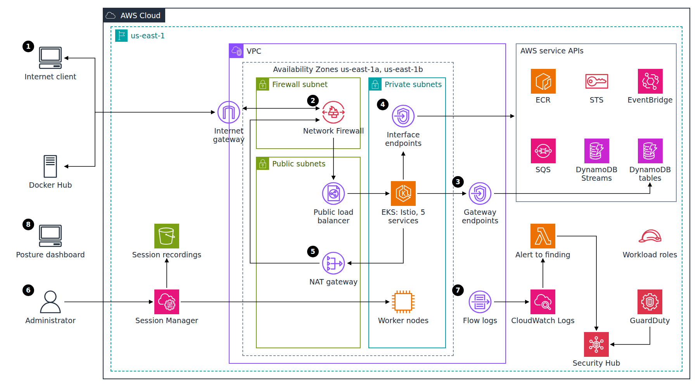
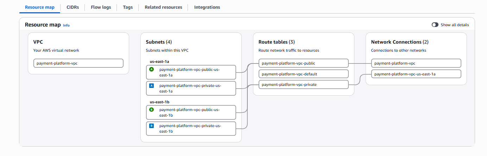
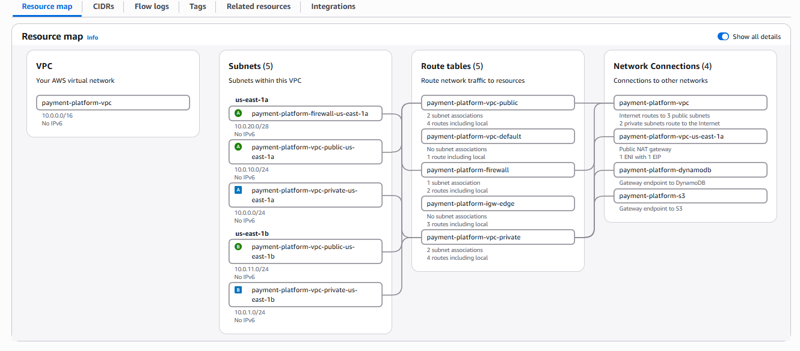
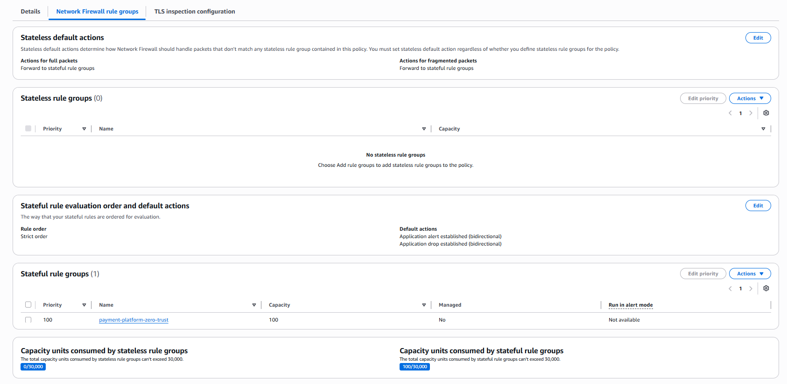
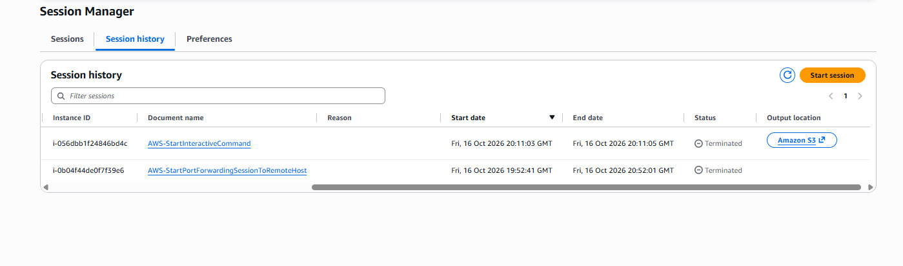
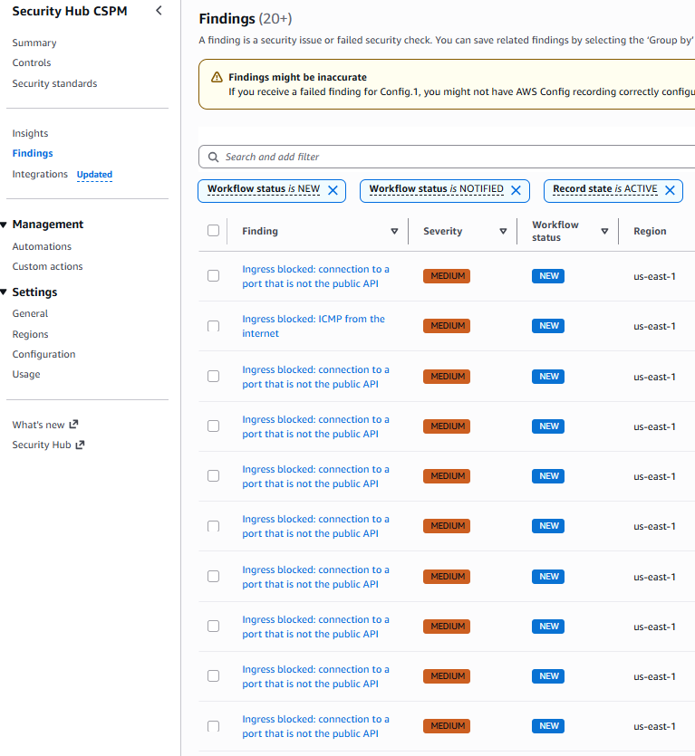
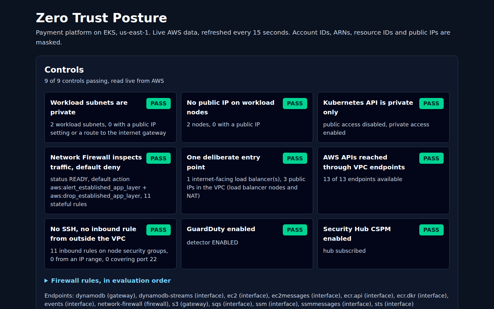
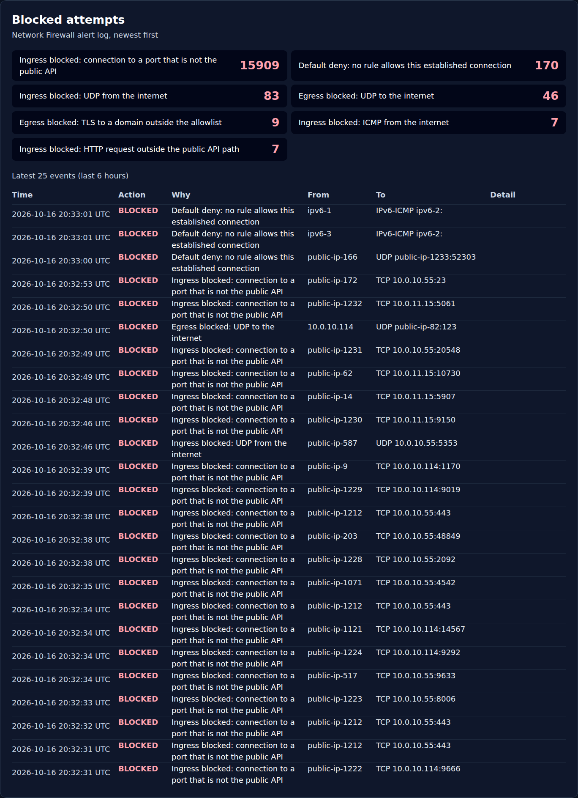
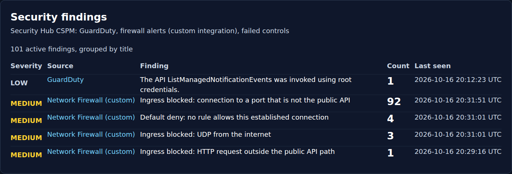
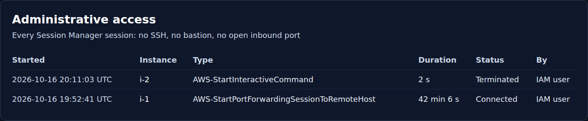

# Zero Trust Network Architecture on AWS

### A working five-service payment platform on EKS, retrofitted with zero trust network controls and measured before and after

---



**Flow:** (1) An internet client reaches the platform through the internet gateway, and the only outbound destination the workload may reach on the internet is Docker Hub. (2) An edge route table sends every packet for the public subnets to the AWS Network Firewall endpoint first; the firewall passes only HTTP requests on port 80 whose path starts with `/api/`, which continue to the public load balancer and the Istio ingress gateway on EKS. (3) The payment services read and write DynamoDB tables through a gateway VPC endpoint, and each service's IAM role denies table calls that do not arrive through that endpoint. (4) Calls to ECR, STS, EventBridge, SQS and DynamoDB Streams go through interface VPC endpoints in the private subnets. (5) Anything else leaving the VPC goes through the NAT gateway and back through the firewall, which drops all TLS except to allowlisted Docker Hub domains. (6) An administrator opens a shell on a worker node through Session Manager, with no SSH key and no inbound rule from outside the VPC, and every session is recorded to S3. (7) VPC Flow Logs and the firewall alert log go to CloudWatch Logs; a Lambda function turns firewall alerts into custom Security Hub findings, next to GuardDuty's findings. (8) A local dashboard reads the state of every control, the blocked attempts, the findings and the admin sessions from the AWS APIs.

---

## Table of Contents

- [The Problem This Project Solves](#the-problem-this-project-solves)
- [What This Actually Is](#what-this-actually-is)
- [Tech Stack](#tech-stack)
- [The Build, in Order](#the-build-in-order)
- [Real Problems Hit and Fixed](#real-problems-hit-and-fixed)
- [Proof It Works](#proof-it-works)
- [Cost Discipline](#cost-discipline)
- [Running This Yourself](#running-this-yourself)
- [Architecture Decisions](#architecture-decisions)
- [Cleanup](#cleanup)

---

## The Problem This Project Solves

Most cloud workloads start from the same defaults: a public load balancer that answers on every port its listeners declare, a Kubernetes API reachable from the whole internet, and outbound traffic that can go anywhere through a NAT gateway. Security groups decide what can connect, but nothing looks at what the traffic contains, and credentials taken from a pod work just as well from a laptop on another continent.

Zero trust removes those implicit assumptions: nothing is reachable because of where it sits, traffic is inspected rather than just allowed, administration needs no open port, and a credential is only valid in the context it was issued for. The usual way to show this is to design a fresh workload around the controls. This project does the harder thing: it takes an existing platform that was built without any of them and retrofits the controls one layer at a time, then measures what changed.

## What This Actually Is

The workload is a payment platform built earlier as a separate project: five FastAPI microservices (wallet, transaction, fraud detection, notification, reconciliation) on Amazon EKS with an Istio mesh, backed by DynamoDB, DynamoDB Streams, EventBridge and SQS, with synthetic wallets only. It was redeployed as it originally was, its exposure was measured, and then the following was added around it:

- **One inspected path in and out of the VPC:** AWS Network Firewall with ingress routing on the internet gateway, strict rule order, default drop, and readable rule messages.
- **A private Kubernetes API:** public access turned off; kubectl reaches the API through a Session Manager port-forwarding session to a node.
- **Private access to AWS services:** two gateway endpoints and ten interface endpoints, chosen from the calls the services actually make.
- **Admin access without an open port:** Session Manager with recorded sessions, no key pair, no bastion.
- **Context-aware IAM:** an explicit deny on each workload role for calls that do not come from the VPC or its DynamoDB endpoint.
- **Detection:** GuardDuty with EKS audit logs, Security Hub CSPM, VPC Flow Logs with the version 5 path fields, and a small Lambda that turns firewall alerts into Security Hub findings.
- **A posture dashboard:** React, served locally, reading live AWS data through a local proxy that masks account IDs, ARNs, resource IDs and public IPs.

Everything ran in one account in us-east-1 for about three hours of billable time, then was destroyed.

## Tech Stack

| Layer | Technology |
|---|---|
| Infrastructure as Code | Terraform 1.15 (S3 backend with native lock files), three stacks: backend, baseline, zerotrust |
| Workload | Amazon EKS 1.35 (2 x t3.medium, AL2023), Istio 1.30 (demo profile), Helm, five Python FastAPI services |
| Data and events | DynamoDB with Streams, EventBridge, SQS |
| Traffic inspection | AWS Network Firewall (Suricata rules, strict order, app-layer default drop) |
| Private service access | VPC gateway endpoints (DynamoDB, S3), interface endpoints (ECR API and registry, EC2, STS, EventBridge, SQS, DynamoDB Streams, SSM, SSM Messages, EC2 Messages) |
| Administrative access | AWS Systems Manager Session Manager, session recordings in S3 |
| Identity | IRSA roles with explicit deny conditions on `aws:SourceVpce` and `aws:SourceVpc` |
| Detection | Amazon GuardDuty, AWS Security Hub CSPM, VPC Flow Logs, CloudWatch Logs, AWS Lambda (Python 3.13) |
| Dashboard | React 19, Vite 7, Tailwind CSS 4, AWS SDK for JavaScript v3 (local proxy only) |
| Measurement | Python TCP connect scanner, AWS CLI, Playwright for automated captures |

## The Build, in Order

1. **Preflight and the original platform.** The original repository still validated, but its Kubernetes version (1.30) is no longer offered by EKS, so the baseline moved to 1.35, the version that sits inside the supported range of the Istio release the platform uses. Account-specific values were removed from the Helm values and are now injected from Terraform outputs at deploy time.
2. **Guardrails before anything billable.** A repository-local pre-push hook blocks account IDs, full ARNs, foreign e-mail addresses, keys, state files and kubeconfigs; it was tested on a failing case before the first push. A 10 USD monthly budget was created before any other resource.
3. **Everything written and validated offline first.** The zero trust stack, the four demo scripts and the dashboard were written and checked before the first billable apply: `terraform validate`, the firewall rules accepted by a Network Firewall `--dry-run` call, the Lambda tested against a sample alert, the dashboard tested headless against the empty account.
4. **Baseline deployed and measured.** The original platform went up with its public load balancer, public Kubernetes API and NAT, and `scripts/posture_snapshot.sh` recorded its subnets, public addresses, security group rules and an external TCP scan of every public endpoint.
5. **Network Firewall in the path.** A dedicated firewall subnet, an edge route table on the internet gateway, and two `/1` routes on the public route table put the firewall on every packet between the internet and the public subnets.
6. **VPC endpoints and the egress allowlist.** Gateway and interface endpoints for every AWS API the services call; the NAT gateway stays, behind the firewall, which only passes TLS to Docker Hub.
7. **Session Manager, no SSH.** The node role gained the Session Manager policy, sessions are recorded to S3, and kubectl reaches the now private API through a port-forwarding session.
8. **GuardDuty, Security Hub and the firewall findings.** GuardDuty with EKS audit logs, Security Hub CSPM with its default standards, and a CloudWatch Logs subscription that feeds firewall alerts to a Lambda function writing custom findings.
9. **IAM context conditions.** Each workload role kept its original allow policy and gained an explicit deny for calls from outside the VPC or, for DynamoDB tables, outside the gateway endpoint.
10. **Private API, demos and the after measurement.** The baseline was applied again with `zero_trust_private_api=true`, then the four scenarios ran, the posture snapshot ran again, and the dashboard was tested on live data.
11. **Teardown and verification.** Both stacks destroyed in reverse order, GuardDuty and Security Hub confirmed off, every service listing checked empty.

## Real Problems Hit and Fixed

Every entry below is in [docs/DEVLOG.md](docs/DEVLOG.md) with its root cause.

- **The original platform no longer deployed.** EKS stopped offering Kubernetes 1.30. Moved to 1.35 and AL2023 nodes, the only change made to the cluster definition.
- **The first pre-push hook printed BLOCKED and let the push through.** The failure flag was set inside a pipeline subshell and lost. It now writes to a file; six test cases confirm the exit code.
- **The first external scan under-reported open ports.** 300 parallel connections from WSL made listening ports look closed, including 443 on the public Kubernetes API. The scanner now uses 64 parallel probes and a second pass; the unreliable output was discarded.
- **DynamoDB Streams has no private DNS name.** The zero trust apply stopped on it, and meanwhile the new IAM deny refused the fraud service's stream reads. The endpoint was created without private DNS and the service is pointed at it with the standard `AWS_ENDPOINT_URL_DYNAMODB_STREAMS` SDK setting.
- **The egress allowlist blocked the allowlisted registry.** In strict order the TLS drop rule matched the first packets of the connection before the Client Hello was parsed, so the SNI-based pass rule never ran. The fix: AWS's application-layer default actions (`aws:drop_established_app_layer`) and drop rules that only match once the SNI or HTTP host is visible.
- **A flow log query was rejected and filtered on the wrong address.** CloudWatch already defines `bytes` for flow logs, and the VPC CNI translates pod traffic leaving the VPC to the node address. Fields were renamed and the query filters on node addresses.
- **The dashboard showed the oldest blocked events and two unmasked identifier types.** The log API returns oldest first and only one page was read; IPv6 addresses and the firewall's endpoint service ID were not masked. Pagination and both masks were added, and the headless test now fails on those patterns.
- **A session ID in a proof file contained the IAM principal name.** Session Manager session IDs start with the caller's name; they are now masked before anything is written to `proof/`.

## Proof It Works

The before and after comparison comes from the same script run twice against the same VPC, with an external TCP scan of 1,046 ports per address from a machine outside AWS.

```bash
scripts/posture_snapshot.sh 02-posture-before   # original platform
scripts/posture_snapshot.sh 08-posture-after    # after the retrofit
```

| Measured | Before | After |
|---|---|---|
| Open TCP ports on the public load balancer (both addresses) | 80, 443, 15021, 15443, 31400 | 80 |
| Kubernetes API endpoint | public, open to 0.0.0.0/0, port 443 open on both addresses | private only, resolves to two private addresses, nothing reachable |
| Open TCP ports on the NAT gateway address | none | none |
| Public IP addresses in the VPC | 3 (two load balancer nodes, one NAT) | 3 (same) |
| Worker nodes with a public IP | 0 of 2 | 0 of 2 |
| Security group inbound rules open to 0.0.0.0/0 | 6 | 6 |
| Traffic inspection | none | Network Firewall on every packet to and from the internet |

The last two rows are stated as measured. The six open rules belong to the security group Kubernetes creates for the Istio load balancer, which still allows ICMP and the five gateway ports; the reduction to port 80 comes from the firewall dropping the other four, not from the security group. Tightening the gateway's own service ports would be the next layer.
Full outputs: [proof/02-posture-before.txt](proof/02-posture-before.txt), [proof/08-posture-after.txt](proof/08-posture-after.txt).

The VPC before the retrofit: two public and two private subnets, one NAT gateway, no inspection.



The same VPC after: a firewall subnet, a firewall route table, an edge route table on the internet gateway, and the gateway endpoints.



**Scenario 1, external scan.** Only the deliberate entry point answers, on port 80 only; see the table above.

**Scenario 2, blocked unauthorized path.** Requests outside the public API path, to the Istio status port, and from a pod to a domain that is not on the allowlist are dropped and logged with a readable reason, while the public API and the allowlisted registry still work.

```bash
scripts/demo_blocked_path.sh 04-blocked-path
```

```text
1. GET /api/wallets (the intended public API path): HTTP 200
2. GET /stats (a service endpoint outside the public API path): no response (curl exit 28)
3. GET /healthz/ready on the Istio status port 15021: no response (curl exit 28)
4. https://registry-1.docker.io/v2/ (allowlisted registry): HTTP 401 (reached the server)
5. https://example.com/ (not on the allowlist): no connection (URLError)
blocked  Ingress blocked: HTTP request outside the public API path  TCP  public-ip-2 -> 10.0.11.15:80  /stats
blocked  Egress blocked: TLS to a domain outside the allowlist      TCP  10.0.10.114 -> public-ip-21:443  example.com
```

Full output: [proof/04-blocked-path.txt](proof/04-blocked-path.txt). The firewall policy that produced it, with strict order and the application-layer default drop:



**Scenario 3, admin session with no open port.** A recorded shell on a worker node that has no public IP, no key pair, no security group rule from an IP range and none covering port 22. The SSH daemon of the EKS AMI is still listening on port 22 inside the node, as the session itself shows; it is unreachable, not absent. The node security group keeps eleven inbound rules that reference the cluster and node security groups, which Kubernetes needs, so the claim here is "no inbound rule from outside the VPC", not "zero inbound rules".

```bash
scripts/demo_admin_session.sh 06-admin-session
```

```text
inbound rules with an IPv4 CIDR source: 0
inbound rules covering port 22: 0
whoami: ssm-user
LISTEN 0      128          0.0.0.0:22         0.0.0.0:*
session-1  Terminated  ...  AWS-StartInteractiveCommand
```

Full output: [proof/06-admin-session.txt](proof/06-admin-session.txt).



**Scenario 4, private path to DynamoDB.** Three transfers through the public API, then VPC Flow Logs for the nodes running the wallet and transaction pods: DynamoDB traffic took `traffic-path` 7 (through a gateway VPC endpoint), and no DynamoDB flow took path 8 (internet gateway).

```bash
scripts/demo_dynamodb_private_path.sh 07-dynamodb-private-path
```

```text
packet_source  aws_service  traffic_path  flows  bytes
10.0.0.81      -            1             4      71080
10.0.0.81      DYNAMODB     7             1      24190
```

Full output: [proof/07-dynamodb-private-path.txt](proof/07-dynamodb-private-path.txt).

**IAM context condition.** The wallet pod scans its table; the same role, assumed from outside AWS with a service account token, is refused by the explicit deny.

```bash
scripts/demo_iam_condition.sh 05-iam-condition
```

```text
scan OK, items returned: 1
assume-role-with-web-identity with a service account token: succeeded
dynamodb scan: An error occurred (AccessDeniedException) when calling the Scan operation: User: arn-1 is not authorized to perform: dynamodb:Scan on resource: arn-2 with an explicit deny in an identity-based policy
```

Full output: [proof/05-iam-condition.txt](proof/05-iam-condition.txt).

**Security Hub.** Firewall alerts arrive as custom findings, because Network Firewall is not a native finding source for Security Hub CSPM (see the decisions below).



**Dashboard.** The four captures below are automated (Playwright, headless Chromium) against live AWS data, taken by `console/e2e/flow.mjs`. The blocked-attempt counters cover six hours and include the scans run for this project as well as unsolicited traffic from the internet.









The GuardDuty finding on the dashboard is real: an API call made with the account's root credentials during the build.

## Cost Discipline

The project had a hard cap of 10 USD in total and a 10 USD monthly budget (no notifications) created before any other resource.

- **Hourly prices from the AWS Pricing API, us-east-1:** EKS control plane 0.10 USD, t3.medium 0.0416 USD, NAT gateway 0.045 USD, Network Firewall endpoint 0.395 USD, interface endpoint 0.01 USD per zone, public IPv4 address 0.005 USD, Classic Load Balancer 0.025 USD.
- **Billable time kept short:** everything was written and validated before the first apply, so the account billed for 3 hours 6 minutes (baseline 18:41 to 21:47 UTC, zero trust controls 19:37 to 21:34 UTC).
- **One firewall endpoint instead of two, interface endpoints in one zone:** the single biggest saving, recorded as a production change to make (ADR-005).
- **GuardDuty and Security Hub on their free trials,** disabled at cleanup.

Cost Explorer showed no charge yet when queried right after teardown; its data lags by up to 24 hours, so no spend figure is given here.

## Running This Yourself

Requirements: an AWS account and CLI profile, Terraform 1.10 or later, kubectl, Helm, istioctl 1.30, Docker, the Session Manager plugin, Node.js, Python 3.

```bash
# 1. Budget first, then the state bucket (writes infra/backend.hcl, git-ignored)
terraform -chdir=infra/backend init
terraform -chdir=infra/backend apply -target=aws_budgets_budget.monthly
terraform -chdir=infra/backend apply

# 2. Original platform
terraform -chdir=infra/baseline/cluster init -backend-config=../../backend.hcl
terraform -chdir=infra/baseline/data init -backend-config=../../backend.hcl
terraform -chdir=infra/baseline/data apply
terraform -chdir=infra/baseline/cluster apply
workloads/deploy.sh                      # builds and pushes 5 images, installs Istio, Helm releases
export API_BASE_URL=http://<load-balancer-hostname>/api
python3 workloads/simulator/simulate.py setup
scripts/posture_snapshot.sh 02-posture-before

# 3. Zero trust retrofit
terraform -chdir=infra/zerotrust init -backend-config=../backend.hcl
terraform -chdir=infra/zerotrust apply
workloads/deploy.sh --skip-build         # points fraud detection at the Streams endpoint
scripts/kube_tunnel.sh start             # kubectl through Session Manager
terraform -chdir=infra/baseline/cluster apply -var zero_trust_private_api=true
export ZT_TUNNEL=1

# 4. Scenarios and the after measurement
scripts/demo_blocked_path.sh 04-blocked-path
scripts/demo_iam_condition.sh 05-iam-condition
scripts/demo_admin_session.sh 06-admin-session
scripts/demo_dynamodb_private_path.sh 07-dynamodb-private-path
scripts/posture_snapshot.sh 08-posture-after

# 5. Dashboard on http://127.0.0.1:5173
cd console && npm install && npm run dev
```

## Architecture Decisions

Each decision has a full record in [docs/DECISIONS.md](docs/DECISIONS.md).

**Retrofitting the existing platform over building a new workload.** Controls proven against a system that was not designed for them, with a measured before, are more credible than a workload shaped to make them look clean.

**Network Firewall over security groups alone.** The after scan shows why: the load balancer's security group still allows five ports, and the firewall is what reduces the reachable surface to one, while also reading the HTTP path and TLS domain.

**One firewall endpoint over one per zone.** 0.395 USD per hour saved under a 10 USD cap; both public subnets route to the endpoint in the first zone. Production should use one per zone.

**Two `/1` routes over replacing the baseline default route.** All internet-bound traffic from the public subnets reaches the firewall without editing a route the baseline stack owns.

**Keeping NAT behind the firewall over removing it.** Istio pulls its proxy image from Docker Hub whenever a pod starts; the firewall allows only TLS to Docker Hub domains, so the NAT path is a narrow allowlist rather than open egress.

**Endpoints from the code over a standard list.** The services call DynamoDB, DynamoDB Streams, EventBridge and SQS, pods need STS, nodes need ECR and EC2. None of them reads a secret, so there is no Secrets Manager endpoint.

**A custom Lambda over claiming a native integration.** The AWS page listing services that send findings to Security Hub CSPM does not include Network Firewall, so firewall alerts are imported as custom findings and labeled as such.

**Session Manager over a bastion host.** A bastion is itself a standing entry point. The trade-off accepted here: the target is an EKS node, because the account's 5 vCPU quota left no room for a separate instance.

**A private Kubernetes API with a Session Manager tunnel over an IP allowlist.** An allowlisted public endpoint would still answer the scan from the build machine.

**An explicit deny on the existing roles over rewriting their policies.** The original allow policies stay untouched; the deny on `aws:SourceVpce` and `aws:SourceVpc` wins over them and makes a stolen token useless outside the VPC.

**Considered and rejected:** multi-account governance (a different problem), a third-party ZTNA product (vendor configuration rather than cloud architecture), Transit Gateway (this is a single-VPC retrofit).

## Cleanup

The Istio load balancer was deleted through Kubernetes first, because Terraform does not own it, then the zero trust stack (55 resources) and the baseline (14 and 77 resources) were destroyed. GuardDuty shows no detector and Security Hub reports the account as not subscribed.

```bash
kubectl -n istio-system delete svc istio-ingressgateway
terraform -chdir=infra/zerotrust destroy
terraform -chdir=infra/baseline/data destroy
terraform -chdir=infra/baseline/cluster destroy -var zero_trust_private_api=true
```

Every service listing (EKS, EC2 instances and volumes, Elastic IPs, NAT gateways, VPCs, network interfaces, load balancers, Network Firewall, VPC endpoints, CloudWatch log groups, ECR, DynamoDB, SQS, Lambda, IAM roles, GuardDuty, Security Hub) returned zero. The EKS secrets KMS key stays in its 30-day pending-deletion window, set by the EKS module, and is then deleted by AWS. The Terraform state bucket is removed last.
Full output: [proof/13-cleanup-verification.txt](proof/13-cleanup-verification.txt).
